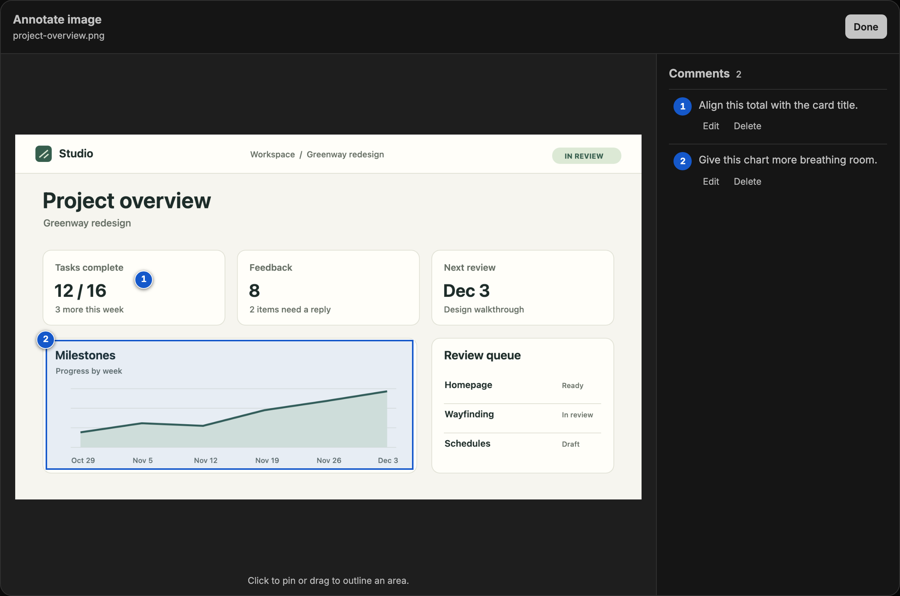
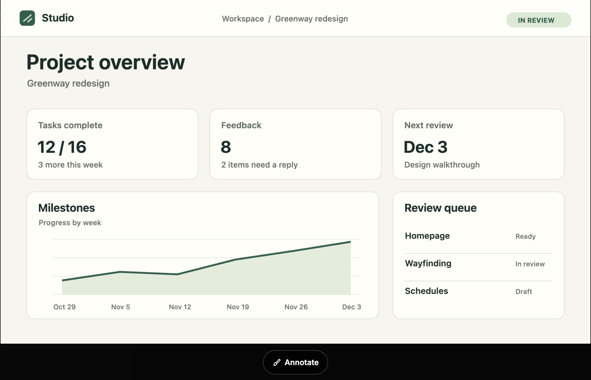
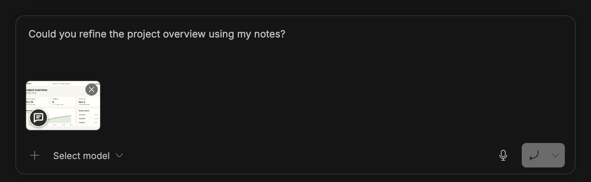

# Image Annotations for BB

Pin feedback to a point or rectangle on an image in your BB draft. BB sends the
image and its comments together when you send the message.

## See it in BB

**Pin a comment or outline an area**



| Open Annotate from the image preview | Spot annotated images in your draft |
| --- | --- |
|  |  |

## Install

Install the latest compatible `0.1.x` version from Git.

```sh
bb plugin install 'git:https://github.com/fusioneery/bb-plugin-image-annotations.git@semver:^0.1.0'
```

Tested on BB 0.50.1. Requires Plugin SDK 0.6.157 or later and BB's built-in
composer.

## Annotate an image

1. Paste or attach an image to a draft, then open its thumbnail.
2. Choose **Annotate** below the image. Click to add a pin or drag to outline a
   rectangle.
3. Write a comment and choose **Add comment**. Select a numbered marker to edit
   its comment. Choose **Done** to return to the draft.

An annotation icon on the thumbnail shows which images have comments. Open the
image again to edit or delete them. Removing the image or deleting its last
comment also removes the attached notes.

For keyboard input, focus the image and use the arrow keys to move the
crosshair. Press **Enter** to pin a comment. To draw a rectangle, press
**Shift+Enter**, move diagonally, then press **Enter** again. Pressing **Escape**
closes the editor and saves the comments.

## Data handling

The plugin uses BB's project attachment storage and makes no external service
requests. Comments are kept in a Markdown attachment with numbered notes and
coordinates measured from the top-left corner of the image. The composer shows
the annotation icon on the image. BB includes the Markdown in the agent input
when you send the draft, and the plugin hides its file chip from the message.
If you remove the image while editing a sent message, remove the notes file
that reappears in the editor as well.

## Develop locally

Clone the repository and run these commands from its root with Node.js 22.18 or
later and the BB CLI.

```sh
npm ci
npm run check
npm test
npm run build
bb plugin install .
```

Use `bb plugin reload image-annotations` after rebuilding changes in a local
installation.
